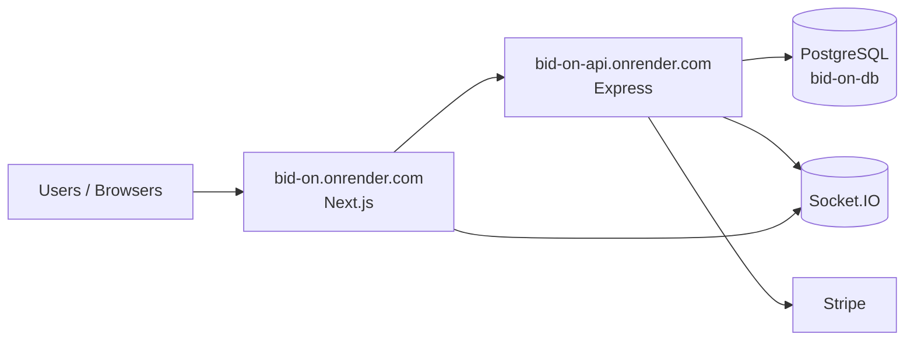
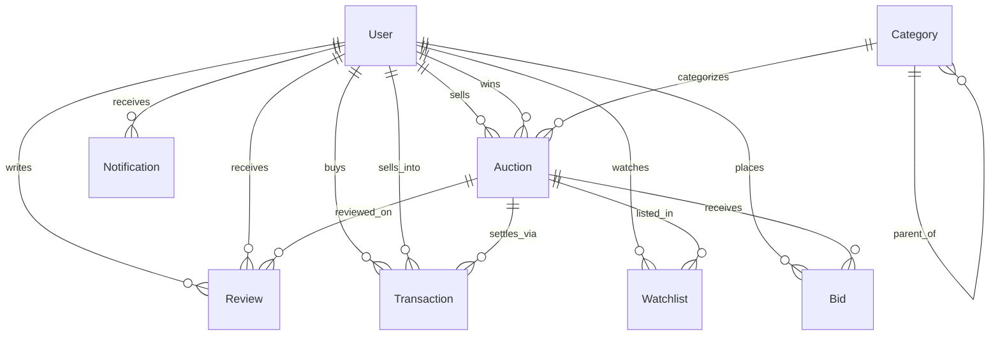

# Bid On — Database Architecture

**Document type:** Technical architecture (management submission)  
**System:** Bid On online auction platform  
**Stack:** PostgreSQL 16 · Prisma ORM · Express API · Next.js frontend  
**Environments:** Local · Render (`bid-on.onrender.com` + `bid-on-api.onrender.com`)  
**Version:** 1.1 · November 2026  
**Status:** Editable source — export to PDF via Word / Google Docs / browser Print  

---

## 1. Purpose

This document describes the **logical and physical database design** for Bid On: entities, relationships, money/escrow rules, indexes, and operational notes for hosting on Render Postgres.

It is intended for management review, audit, and handoff to engineering or hosting partners.

---

## 2. System context

| Layer | Technology | Role |
|-------|------------|------|
| Frontend | Next.js 15 (App Router) | Buyer / seller / admin UI |
| API | Express 5 + Prisma 5 | Auth, auctions, bids, payments, admin |
| Database | PostgreSQL 16 | System of record |
| Realtime | Socket.IO | Live bids & notifications |
| Payments | Stripe Checkout + escrow ledger | Winner payment held until release |



---

## 3. Design principles

1. **Single source of truth** — all auction, bid, escrow, and KYC state lives in PostgreSQL.  
2. **Role-based access** — `buyer`, `seller`, `admin` encoded on `User.role`.  
3. **Listing moderation** — new lots start as `pending` until admin approval (`live`).  
4. **Escrow before settlement** — winner payment is recorded as `held` before seller payout / release.  
5. **Money as Decimal** — prices and bids use `Decimal(12,2)` (not floating point).  
6. **Soft operational limits** — free Render disk is ephemeral; image URLs may be remote or `/uploads`.  

---

## 4. Entity–relationship overview



---

## 5. Entity catalogue

### 5.1 User

Central identity and compliance profile.

| Field group | Fields | Notes |
|-------------|--------|-------|
| Identity | `id` (cuid), `name`, `email` (unique), `passwordHash` | Email unique |
| Access | `role`, `verified`, `suspended` | Roles: buyer / seller / admin |
| Auth OTP | `otpCode`, `otpExpiresAt`, `resetOtpCode`, `resetOtpExpiresAt` | Email verify & password reset |
| Profile | `phone`, `address`, `ratingAvg`, `ratingCount` | Aggregated from reviews |
| KYC | `kycStatus`, name/doc fields, submit/review timestamps | `none` → `pending` → `approved`/`rejected` |
| Bank | `bankStatus`, account fields, submit/review timestamps | Required before sell/bid (compliance) |

**Relations:** sells auctions, places bids, watchlist, notifications, buyer/seller transactions, reviews given/received, won auctions.

---

### 5.2 Category

Hierarchical catalogue for browsing/filtering.

| Field | Type | Notes |
|-------|------|-------|
| `id` | cuid | PK |
| `name` | string | Display |
| `slug` | string unique | URL / filter key |
| `parentId` | optional FK → Category | Tree structure |

---

### 5.3 Auction

Core listing and auction clock.

| Field | Type | Notes |
|-------|------|-------|
| `sellerId` | FK → User | Owner |
| `categoryId` | FK → Category | Required |
| `title`, `description`, `images[]` | text / string array | Listing content |
| `startPrice` | Decimal(12,2) | Opening price |
| `reservePrice` | Decimal? | Optional secret floor |
| `maxPriceCap` | Decimal? | Optional ceiling |
| `currentBid` | Decimal | Leading bid (0 = none yet) |
| `minBidIncrement` | Decimal | Step after first bid |
| `bidCount` | int | Denormalized counter |
| `status` | enum | See lifecycle |
| `startsAt`, `endsAt` | datetime | Clock |
| `winnerId` | FK? → User | Set when ended with reserve met |
| `rejectReason` | string? | Admin rejection note |

**Indexes:** `status`, `endsAt`, `categoryId`.

**Lifecycle (`AuctionStatus`):**

```text
pending ──approve──► live ──time/force end──► ended
   │                              │
   └──reject──► cancelled         └──payment──► sold (via escrow completion path)
```

---

### 5.4 Bid

Immutable bid events (history). Cascade-deleted with auction.

| Field | Type | Notes |
|-------|------|-------|
| `auctionId` | FK | Cascade on delete |
| `bidderId` | FK → User | |
| `amount` | Decimal(12,2) | Must meet `minimumNextBid` |
| `createdAt` | datetime | Tie-break: earliest wins at same amount |

**Concurrency:** API locks the auction row (`SELECT … FOR UPDATE`) before accepting a bid so `currentBid` cannot go backwards under race.

---

### 5.5 Watchlist

User ↔ auction favourites. Unique `(userId, auctionId)`.

---

### 5.6 Notification

In-app alerts (`outbid`, `ending_soon`, `won`, `approved`, `rejected`, `general`) with optional JSON `meta`. Indexed by `(userId, read)`.

---

### 5.7 Transaction (escrow ledger)

Records payment / hold / dispute / release for a won auction.

| Field | Type | Notes |
|-------|------|-------|
| `auctionId`, `buyerId`, `sellerId` | FKs | Parties |
| `amount` | Decimal | Charged / held amount |
| `stripeSessionId` | string? **unique** | Prevents duplicate session rows |
| `stripePaymentId` | string? | PaymentIntent id |
| `status` | enum | See escrow lifecycle |
| Hold / ship | `heldAt`, `releaseDueAt`, `shippedAt`, `releasedAt` | 7-day hold after ship by default |
| Dispute | `disputeReason`, `disputedAt`, `resolvedAt`, `resolveNote` | Admin resolution |

**Indexes:** `(auctionId, status)`, `buyerId`, `sellerId`.

**Escrow lifecycle (`TransactionStatus`):**

```text
pending → held → completed
              ↘ disputed → completed | refunded
              ↘ failed | refunded
```

**Management note:** Seller bank release is recorded in-app (`completed`). Full Stripe Connect automated payout to seller accounts is a recommended Phase-2 enhancement.

---

### 5.8 Review

Post-sale rating. Unique `(auctionId, fromUserId)`. Updates `User.ratingAvg` / `ratingCount`.

---

## 6. Enumerations (controlled vocabularies)

| Enum | Values |
|------|--------|
| `Role` | buyer, seller, admin |
| `AuctionStatus` | pending, live, ended, cancelled, sold |
| `TransactionStatus` | pending, held, disputed, completed, failed, refunded |
| `VerificationStatus` | none, pending, approved, rejected |
| `NotificationType` | outbid, ending_soon, won, approved, rejected, general |

---

## 7. Key business rules (database-adjacent)

| Rule | Enforcement |
|------|-------------|
| Opening bid ≥ `startPrice` | API `minimumNextBid` |
| Later bids ≥ `currentBid + minBidIncrement` | API + row lock |
| Cannot bid on own listing | API |
| Bid / sell requires KYC + bank approved | API compliance gate |
| Only `pending` listings approved/rejected | API |
| Live auctions close via job / force-end | `auctionEnder` job |
| Reserve not met → no winner | `finalizeAuction` |
| Checkout requires paid Stripe session in production | API (dev bypass only if `ALLOW_DEV_PAYMENTS`) |
| One Stripe session → one transaction row | Unique `stripeSessionId` |

---

## 8. Physical deployment (Render)

| Resource | Name | Region | Notes |
|----------|------|--------|-------|
| Postgres | `bid-on-db` | Singapore | Free plan; private network; PG 16 |
| API | `bid-on-api` | Singapore | Internal `DATABASE_URL` |
| Website | `bid-on` | Singapore | Public UI |

- Migrations apply on API start: `prisma migrate deploy`.  
- Free Postgres expires ~30 days after creation unless upgraded.  
- Free web services sleep after idle; first request may be slow.

---

## 9. Security & privacy notes

| Topic | Current approach | Recommendation |
|-------|------------------|----------------|
| Passwords | bcrypt hash | Keep; never store plaintext |
| Sessions | JWT httpOnly cookie + optional Bearer | Prefer cookie-only long term |
| Secrets | `JWT_SECRET` required in production | Rotate periodically |
| KYC documents | Files under `/uploads` (public static) | Move to private object storage + signed URLs |
| CORS | Production: `FRONTEND_URL` + `https://bid-on.onrender.com` | Keep localhost only in development |
| Socket notifications | Room joined only for authenticated user id | Do not accept arbitrary `user:join` |

---

## 10. Capacity & indexing summary

| Table | Primary access patterns | Indexes |
|-------|-------------------------|---------|
| Auction | List live by status/end time; filter category | status, endsAt, categoryId |
| Bid | History by auction; top bid | auctionId, bidderId |
| Transaction | Escrow by auction/status; buyer/seller dashboards | auctionId+status, buyerId, sellerId, unique stripeSessionId |
| Notification | Unread feed | userId+read |
| User | Login by email | unique email |
| Category | Browse by slug | unique slug |

---

## 11. Schema source of truth

Engineering maintains the Prisma schema at:

`backend/prisma/schema.prisma`

Migrations under:

`backend/prisma/migrations/`

Any structural change must:

1. Update `schema.prisma`  
2. Add a migration SQL  
3. Deploy API (`prisma migrate deploy`)  
4. Update this document’s version table  

---

## 12. Document control

| Version | Date | Author | Changes |
|---------|------|--------|---------|
| 1.0 | 2026-11 | Engineering | Initial architecture for management |
| 1.1 | 2026-11 | Engineering | Bid locking, escrow session uniqueness, production secret/CORS hardening |

---

## Appendix A — How to produce a PDF

**Option 1 (Word / Google Docs)**  
1. Open this Markdown file.  
2. Copy into Word or Google Docs (or use a Markdown import add-on).  
3. Export / Download as **PDF**.

**Option 2 (Browser)**  
1. Open `docs/DATABASE_ARCHITECTURE.html` in Chrome/Edge.  
2. **Print → Save as PDF** (A4, backgrounds on).

**Option 3 (Pandoc)**  
```bash
pandoc docs/DATABASE_ARCHITECTURE.md -o BidOn_Database_Architecture.pdf
```

---

*End of document*
